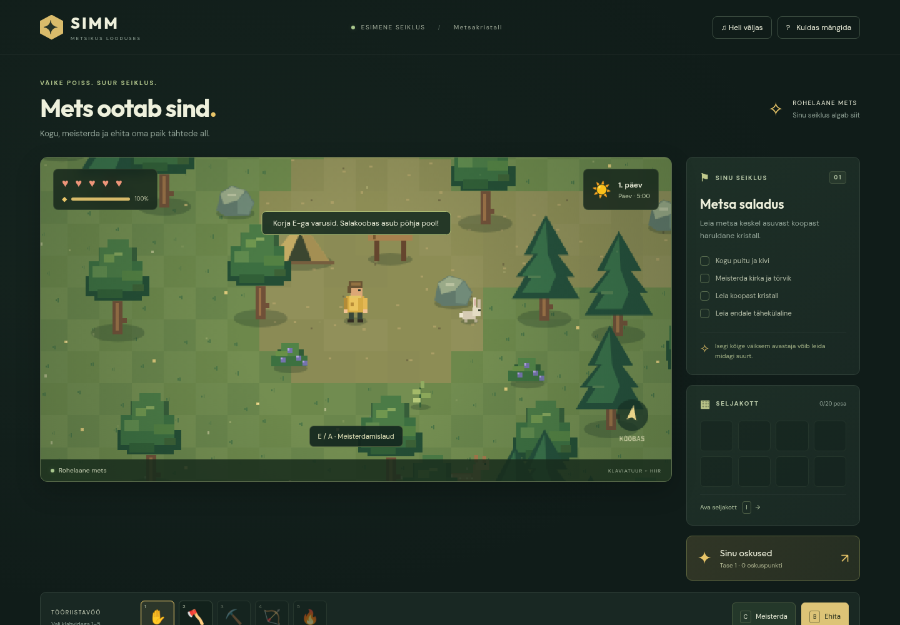
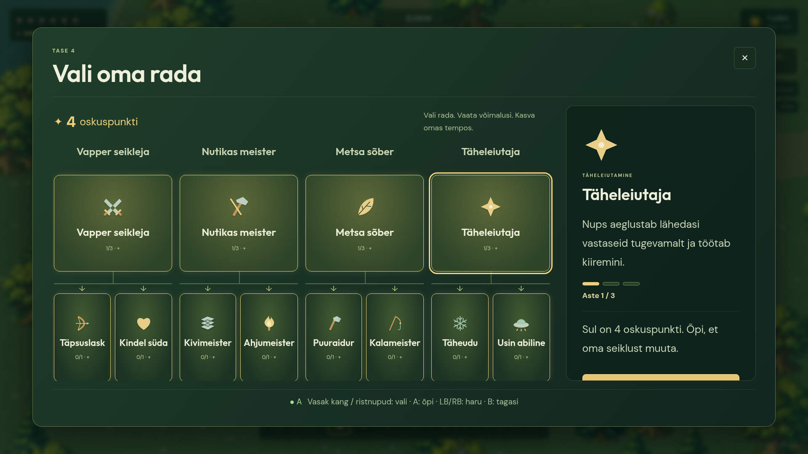
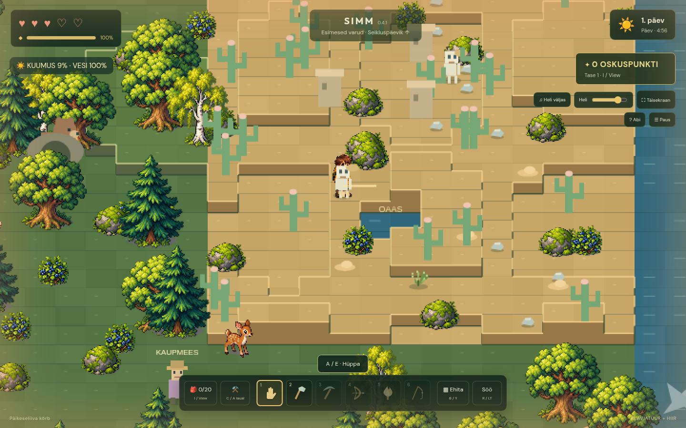
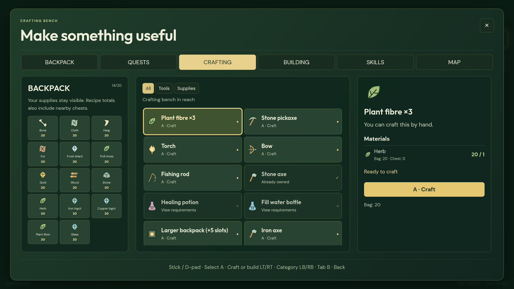

# SIMM — In the wild · 0.5.0

A browser survival adventure designed with Mattis. English is the default language; choose English or Eesti on the title screen, in the HUD, or from Pause. Text and NPC dialogue switch immediately, and the language preference persists independently of your game save. The game fills the browser window; the toolbar, health, time and unspent skill points stay inside the game. All graphics, fonts and original synthesized sound are local.







## Try without installation

Download [index.html](https://github.com/commonCEO/SIMM-IN-THE-WILD/raw/refs/heads/main/index.html) and open it in a current desktop browser. Alternatively download the repository ZIP, extract it, and open the root `index.html`. `play/index.html` is an identical standalone copy. No server or asset downloads are required. Press the fullscreen button or F11 for browser fullscreen.

Saves use browser localStorage. Earlier saves are migrated when available. Browsers may store file-URL saves separately when you change the downloaded filename or folder. Gamepad support and local save behavior on file URLs depend on the browser; an HTTP server provides a stable origin when needed. Physical Xbox playtesting is still needed for 0.4.

## Start a new adventure

Choose **Uus mäng** on the title screen (Xbox Y), or open Pause with Escape / Xbox Menu and choose **Uus mäng**. When replacing an existing save, the in-game confirmation starts with **Cancel** selected. Choose **Jah, alusta uut mängu** to reset the world, inventory, tools, skills, quests and creatures. No browser-native confirmation dialog is required.

## Version 0.5 — a wider world and a controller workbench

- Crafting/building now show inventory, a recipe list and the selected recipe side by side. All recipes have icons, stock counts and clear requirements. LT/RT changes categories, LB/RB changes tabs, A acts and B returns. Basic recipes come first, selection is retained, and unavailable recipes can be inspected. The skills view has compact, predictable branches. The precise world-building cursor remains intact.
- Six NPCs use Mattias's approved designs: **Bronkings** (22), **Diego** (7), **Karjon** (165), **Anyo** (36), **Salty** (27) and **Leina** (13). They have individual portraits, world sprites, dialogue and delivery quests in both languages. Diego is a wild jungle child with his pet rat; Bronkings stays bald.
- The world is **128×96 tiles**, four times the area: larger forest, desert and sea, a southern jungle and much higher snowy mountains. Foxes, white hares, arctic foxes, polar bears, ibex, small trolls and jungle predators inhabit it. The more distant cave is hidden on the map until found; Karjon offers a clue.
- Defeated enemies leave collectable materials. Bones reinforce bows, cloth becomes fibre, fangs/fur make a health charm, troll moss makes healing salve, and frost shards make lanterns. Wildlife also supplies food/fur. Drops and their expiry survive saving.
- Very rare rainbows can reveal gold at their end. Find and collect it before the event fades, then craft a golden lantern. Reloading cannot claim the same treasure twice.
- Existing saves preserve inventory, camp buildings and completed quests; old sea boats move to the new coastline. Terrain uses bounded visible-chunk caching for the larger map. Both standalone HTML files still embed the art and need no asset server.



Run `npm run test:v05` for the new world, NPC, loot, rainbow and controller/layout scenarios. The [design and research notes](docs/v05-design-notes.txt) distinguish published guidance from what was actually tested. The [0.5 test report](docs/e2e-results-v05.txt) records results and limitations.

## Version 0.4.3 — precise controller building and clearer feedback

Selected improvements: 1, 2, 3, 4, 5, 6, 7, 10, 11, 13, 14, 17, 18 and 19.

- Nearby loose branches, pebbles and sand have subtle markers. The interaction prompt identifies the selected action; nearby stations and doors take priority over harvesting, and tools help choose between resource targets.
- Recipe cards list missing materials using both backpack and nearby chest supplies. The first-pickaxe guide tracks wood, stone, herbs and fibre; a compact quest tracker then shows NPC delivery progress.
- Full-backpack failures retain the resource or drop harvested goods on the ground. The warning stays visible. Successful pickups show floating item quantities.
- **Xbox building:** Y opens Building. Select a piece with the left stick or D-pad and A. In the world, the right stick or D-pad moves a cursor exactly one tile at a time, in screen directions for the current camera. Left stick moves Simm without moving the selected world tile. A or RT places, X rotates walls and B finishes. A stale mouse position cannot override gamepad placement. Hold a direction to repeat after a short delay.
- The selected piece stays active for repeated placement. Its panel shows tile coordinates, material stock, how many pieces remain affordable, and a specific reason when placement is blocked. Mouse aiming/clicking still works.
- In a chest, A moves one item and X moves a stack of up to 20 from the selected row. Mouse users have a separate stack button. Withdrawals respect backpack capacity, including a partially fitting stack.
- Garden prompts and menus show the growth stage and approximate minutes until harvest. Damage highlights hearts and displays the remaining temporary protection period.
- Menus, item/skill names, quests, NPC text, HUD, hints and help support English and Estonian. Language changes preserve gameplay IDs and save data. No new recorded dialogue is included in this version.

Run `npm run test:v043` for the controller placement, language persistence, interaction priority, material deficits, chest stacks, crop timing, pickup labels and damage-feedback scenarios. Existing Estonian regression tests explicitly select Estonian; the new suite checks the English default and live switching. Gamepad tests wait for actual browser frames so button edges are observed even on slower test machines. See the [0.4.3 verification report](docs/e2e-results-v043.txt).

## Version 0.4.2 — defeat recovery found by continuous E2E

A continuous fresh-game run exposed a gap in the earlier isolated tests: pursuing wildlife could remain at camp after a defeat and repeatedly attack Simm on respawn. Wolves, bears and skeletons now return to their home positions and stay calm for 12 active game seconds after defeat. Prey, inventory and progress remain intact.

`npm run test:respawn` reproduces an actual wolf attack, defeat and recovery, then verifies that a second defeat does not occur at camp. `npm run test:e2e-journey` runs a separate normal-speed session against the standalone build from its title screen, with no injected save, inventory or progression. It gathers and crafts supplies, builds a furnished house, grows carrots, completes the ranger and cave quests, survives the natural day/night cycle and reloads the save. This optional test takes several minutes because crop growth and the six-minute day are not accelerated. Simulated Xbox input, keyboard and mouse are used; resource cooldowns are checked against game time rather than fixed wall-clock delays.

## Version 0.4.1 — material recipes and collision fixes

All recipes were reviewed; the complete base-cost list and material rationale are in [docs/recipes.txt](docs/recipes.txt).

- The **stone pickaxe costs 3 wood + 3 stone + 1 plant fibre**. Rare loose branches and small stones can be collected with A/E, without any tool, for one wood/stone each. A small guaranteed supply near camp prevents a blocked start; additional supplies are scattered sparsely. They replenish over game time and wait while buildings occupy their positions. Existing saves receive these supplies without shuffling the original forest resource IDs.
- One herb makes three plant fibres by hand in the crafting tab, away from a workbench. Fibre supplies bowstrings, fishing line, torch wicks, bags, bedding and bindings. Metal tools need wood, their actual metal and fibre. Bags no longer need wood or star metal.
- Hand-gather desert sand and melt two sand into one glass. Windows and ordinary lanterns use glass; crystal lamps use crystal, copper and a stone base. Potions require water; stew uses meat, carrots, potatoes, herbs and water. Potatoes can be baked at a fire rather than eaten raw. Two stone produce one slab, or two with the mason skill.
- Camp has a level clearing. Hills remain outside it, with clearly outlined ledges and a jump hint when an ascent blocks movement. Interactions no longer reach through a height step and swallow the A press needed for jumping.
- Water rendering and movement use the same tile boundaries, including lakes and the oasis. Older saves that land on water after this correction are moved to nearby free land.
- Walls, windows, doors and furniture use collision shapes matching their visible footprints. Wall strips replace the oversized square blockers; an open door leaves an actual passage. Felled trees and stumps leave no movement blocker, including after save/reload. Walking animation stops when movement is blocked.

Additional validation: `npm run test:recipes-collision` walks a character with only bare hands through gathering, making fibre, crafting a real stone pickaxe and mining. It also checks an actual felled-tree route before/after reload, walking alongside a wall and passing through an opened door. Unit tests check every recipe's materials, supply-chain reachability, sparse loose supplies, inventory overflow, regrowth and shared shore/terrain geometry.

## Version 0.4

- Four-way rotating, tilted 2D view with visible tile tops and elevation sides. Walking stops at an uphill step; A/E jumps when no interaction is available. F always jumps. The initial jump climbs one step; the **Kõrge hüpe** skill adds up to two more. Movement, aiming and mouse placement follow camera rotation.
- Trees return after three game days (18 minutes), plants after one day and hunted wildlife after two. Restoration uses saved game time and waits while a building or raised bed occupies the location. Original forest resource IDs and v0.3 inventory, progression and buildings are preserved on load. Continuing an older save introduces the new predators.
- Wolves pursue Simm but give up beyond 350 world pixels. Bears guard their dens and stop chasing when Simm leaves the 125-pixel home area. The northeast desert adds cacti, stepped dunes, a cooling oasis, ruins and silly skeletons. Heat and thirst are visible there; drink water from the backpack, collect cactus water or visit the oasis. At a shore, open the crafting tab to fill a water bottle without a workbench.
- Build a **rectangular foundation at least 3×3**, put a wall, window or door on every boundary tile, include at least one door, and roof **every foundation tile**. Floors, walls and roofs occupy separate layers. A completed footprint becomes a whole house with a pitched roof. A at its door opens a separate, larger interior with an 8×6 usable building area.
- Interiors support tables, beds, chests, lamps, fires, furnaces, ceilings and stairs. Cover all 48 interior cells with ceilings and add stairs to unlock the next floor; repeat for additional floors. A near the entrance goes downstairs, or outside on the ground floor. Furniture and chest contents are saved separately per house and floor. A bed restores health and advances the day.
- Each chest has its own inventory. A transfers one selected item in either direction. Crafting, cooking, smelting and building use backpack materials first, then chests within 120 world pixels in the same scene and floor. Failed crafts and full-backpack withdrawals preserve all materials.
- Raised beds include seeds, need no watering and grow carrots, potatoes, berries, medicinal herbs or magic flowers. Growth takes 180–300 active game seconds; plants visibly grow and show **SAAGIKÜPS** when ready. Carrots and berries can be eaten directly; potatoes can be baked or used in stew. Herbs, berries, carrots and magic flowers supply potion recipes and NPC requests.
- Workbench potion recipes: healing (2 herbs + 2 berries + 1 water), speed (1 magic flower + 1 carrot + 1 water), animal peace (1 magic flower + 2 herbs + 1 water). Select a potion in the backpack to drink it. Healing restores up to four hearts; speed lasts 90 seconds and animal peace 120 seconds. Active effect durations are visible on the HUD and pause with the world.
- Build a rowing boat in the water at the eastern shore, board with A and row out to the whale near the eastern map marker. A starts a friendly light-harpoon encounter: the illuminated line appears before the tracking minigame. Hold RT/Space to raise the marker, release to lower it, and keep it in the gold zone. Successful capture offers release; the whale waves goodbye and grants a sea pearl. B cancels without a reward. Row back near the shore and press A to disembark.
- The ranger near camp, miner by the cave and trader to the east offer short **UPPERCASE** dialogue and one quest each. Their tasks involve carrots, smelted iron and magic flowers. Rewards and completion persist in the save.
- Table lamps, wall lanterns, yard lanterns and crystal lamps can be built outside or inside and glow continuously without fuel. Table and wall lamps can share a tile with furniture / a wall.

The game remains an Estonian, child-friendly survival/building adventure without blood or horror effects. PEGI 7 is a design target, not an official rating. No marketplace publishing is part of this version.

### Validation and current limits

`npm run check`, `npm test`, `npm run test:recipes-collision`, `npm run test:browser`, `npm run test:menus`, `npm run test:v04` and `npm run test:standalone` cover the model, preserved survival systems, simulated Xbox input, new activities and embedded builds. The browser tests require Chromium/Playwright and a running `npm run dev`; set `CHROMIUM_PATH` if needed. `npm run build` regenerates both standalone HTML files. The managed Chromium policy blocks direct `file://` navigation in this environment; standalone behavior is therefore also checked by injecting the embedded HTML without asset requests and by opening both builds over local HTTP. File-URL save behavior on a normal desktop browser remains a manual check.

The camera is a projected 2D view with four fixed rotations. Houses currently use rectangular footprints and a standard 8×6 interior on every floor; the footprint is not a freeform architectural editor. New creatures, NPCs, props and houses use simple procedural pixel art alongside the existing artwork. Each NPC has one quest, the first sea encounter uses one whale location, and sea pearls are collectible keepsakes. World time advances only while playing, not while a menu is open or the game is closed. Test input is simulated; physical Xbox hardware, long play sessions and game balance still need playtesting. Touch controls, spoken dialogue/ElevenLabs and itch.io publication remain future work.

## Version 0.3

- Original pixel-art forest, Simm walking frames, creatures, cave, campsite, ore, buildings, textured floors, water edges and title portraits. The art and fonts are embedded in the downloadable file.
- Large fullscreen menus scale for 720p through 4K. Crafting/building cards show available material counts.
- Controller navigation responds immediately to a new stick/D-pad direction. Hold-repeat starts after 260 ms, then repeats every 85 ms. The world renderer freezes while a menu is open; unchanged footer text is not rewritten each frame.
- Skill nodes stay selectable even when locked. Navigate in their actual directions, inspect prerequisites in a large side panel, and press A / Enter to learn. Selection stays on the same node after upgrading; bumpers switch branches.
- Right-stick scroll works in long menus and the detail panel. Keyboard/mouse remain supported.
- A brief startup readiness state decodes the embedded art and draws the title background once before enabling play, keeping early controller taps out of the initial render work.
- New Game and Pause work entirely with the controller. RS opens skills directly; Menu opens Pause.
- Adventure journal guides gathering, crafting, the crystal, Nups, building shelter, surviving nights and constructing a crystal beacon. Journal is J / D-pad Up or the quest HUD button.
- Shooting-star arrival, flickering fire, canopy visibility, cached textured terrain and water boundaries matching the collision model improve atmosphere and performance.

## Controls (0.4)

| Action | Keyboard / mouse | Xbox standard mapping |
| --- | --- | --- |
| Move relative to the camera | WASD / arrows | Left stick |
| Interact, open door, enter house / boat; otherwise jump | E; F always jumps | A |
| Rotate camera through four directions | Z / V | D-pad Left / Right |
| Aim | Mouse | Right stick |
| Tool / bow charge | Hold Space or mouse; release to shoot | Hold RT; release to shoot (X taps tool) |
| Open shared menu at **SELJAKOTT** | I, C, B, K or J; HUD buttons | View, Y, RS or D-pad Up |
| Switch shared-menu tabs | [ / ] or Tab; click a tab | LB / RB |
| Select / confirm / close in menus | Arrows / Enter / Escape | Left stick / D-pad / A / B |
| Scroll menus / skill details | Mouse wheel | Right stick |
| Pause / New Game | Escape | Menu |
| Eat best food | R | LT |
| Nups wait / follow | T | B |
| Rotate wall / door while building | Q | X |
| Place / cancel building | Click / Escape | A / B |
| Select tool outside menus | 1–6 / toolbar | LB / RB |
| Whale minigame: raise marker / let it fall | Hold / release Space | Hold / release RT |

The shared menu always opens at the backpack; each tab retains its selection and scroll position. Its order is **SELJAKOTT → ÜLESANDED → MEISTERDAMINE → EHITAMINE → OSKUSED → KAART**. An interaction with a workbench, fire, chest, garden or NPC opens that activity directly.

Sound starts off. Toggle it using the sound button; its louder default is adjustable with the volume slider.

## Version 0.2

- Full-window game with an internal hotbar and prominent unspent skill points. Browser fullscreen is optional.
- Controller menus manage their own visible selection and support both the stick and D-pad. RT reads analog values as well as the pressed flag.
- Interactions require proximity and highlight the eligible object. The workbench is usable within 46 world pixels.
- Buildings use a grid and green/red placement preview. Connected horizontal and vertical walls, corners and manually rotated walls/doors make the floor plan legible. Enclosing a room with walls and a door protects Simm.
- The axe removes stumps for less wood and breaks a wood wall in three hits. Half its original wood cost is dropped for pickup.
- Four skill roots each have two alternative specializations with visible prerequisites: combat, crafting, gathering and star invention.
- Holding/releasing a bow action launches a real directional projectile. Charge increases distance and damage. A facing marker and aiming guide show the direction. Rabbits and deer can be hunted without blood or graphic effects.
- Wildlife spawns on land, checks water boundaries while moving, and persists in saves.
- Night enemies are fewer, slower and weaker. Damage flashes the screen and player, with a shared period of invulnerability to prevent multiple simultaneous hits. Defeat fades out, restores Simm at camp, then fades into the next morning, retaining inventory.
- Nups follows at a distance. B/T leaves him waiting at his current position or recalls him when nearby. While following he slows nearby enemies; while waiting near a nest he brings berries. Skill specializations expand these abilities.
- Cave deposits provide iron and copper ore. A fueled furnace creates ingots and stone slabs; ingots upgrade the axe/pickaxe at the workbench and slabs make stone flooring.
- A crafted fishing rod catches fish from the shore. Campfires cook fish, meat and berry/herb stew.
- The bag has 20 slots with stacks of 20, separate from tools. Workbench upgrades add five slots each, up to 40. Dropped items remain visible, can be picked up, and expire after 10 simulated minutes. Menus pause this timer along with the game.

## Development and checks

Requires Node.js 20+. No application API keys, accounts, or external services are required. Developers edit `src/index.html`, `src/game.js`, `src/model.js`, `src/audio.js` and `src/style.css`.

```sh
npm ci
npm run dev
```

In this cloud machine use `npm ci --cache /workspace/.cache/npm` to keep the cache in a writable directory. The server listens on port 3000; `PORT` overrides it. The development server serves the source template at `/`; the generated standalone build is at `/index.html`.

```sh
npm run check
npm test
npm run build
CHROMIUM_PATH=/usr/bin/chromium npm run test:recipes-collision
CHROMIUM_PATH=/usr/bin/chromium npm run test:browser
CHROMIUM_PATH=/usr/bin/chromium npm run test:menus
CHROMIUM_PATH=/usr/bin/chromium npm run test:v04
CHROMIUM_PATH=/usr/bin/chromium npm run test:standalone
```

The gameplay and menu browser tests need the running server; the standalone suite reads the generated HTML directly. `TEST_URL` can override its address. On other machines install Chromium with `npx playwright install chromium` and omit `CHROMIUM_PATH`. Build refreshes both standalone HTML files deterministically and embeds font license text. The menu suite checks rapid stick reversal, spatial navigation, prerequisite previews, learning, retained focus, controller-only reset/cancel and fullscreen layouts. Its latency figures are browser simulations, not physical-controller measurements. The normal suite checks capacity, crafting, progression, drops/expiry, bow charge and building orientation. Browser checks exercise controller crafting/menu navigation, real gathering, building/demolition, cave quest, cooking, smelting, fishing, bow hunting, companion behavior, nighttime protection, and saves.

Cloud tasks already run in isolated environments; use the existing checkout rather than a Git worktree unless explicitly requested.

## Future release

PEGI 7 is the art/content target; no official age rating has been obtained. Intended itch.io price: €4.99. The game has not been published there. Touch controls, ice/volcano biomes, more biomes and quests, gold/tin/bronze and release balancing remain future work. Fonts include their SIL Open Font License notices; no downloaded music or commercial asset subscriptions are used.
